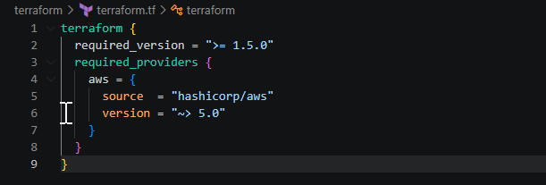
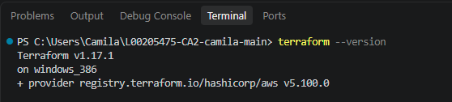

# L00205475-CA2-camila
CA2 for the IaC Devops pipelines module

The initial setup was done using the repository from https://github.com/hashicorp-education/learn-hcp-terraform/tree/main which was based [Get Started with HCP Terraform tutorial collection](https://developer.hashicorp.com/terraform/tutorials/cloud-get-started)

This repository contains the following files:

- `terraform.tf`: Configures Terraform and the AWS provider.
- `main.tf`: Defines one AWS EC2 instance.
- `variables.tf`: Defines two variables named `instance_name` and `instance_type`, both with default values.
- `outputs.tf`: Defines one output named `instance_hostname`.

Terraform file configuration is based on the output of the terraform -version command. Ref.: https://developer.hashicorp.com/terraform/tutorials/aws-get-started/aws-create

References:

https://developer.hashicorp.com/terraform/tutorials/aws-get-started/aws-create Accessed on 11/11/2026
https://developer.hashicorp.com/terraform/tutorials/policy/sentinel-cloud-integration Accessed on 10/11/2026
