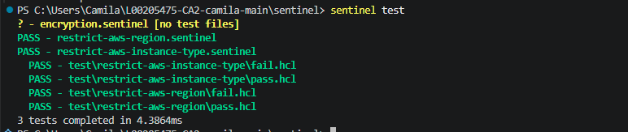
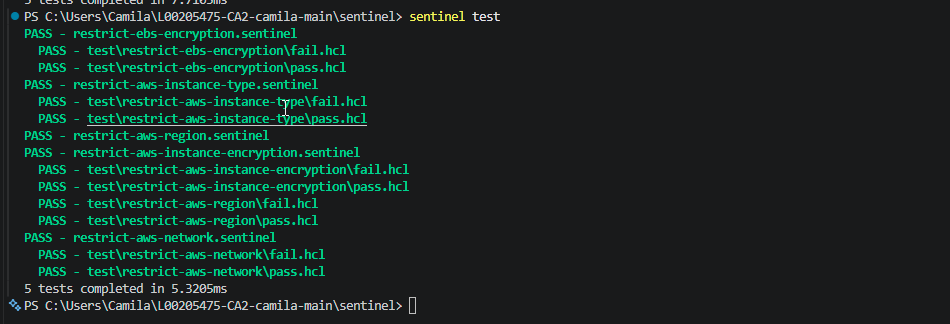
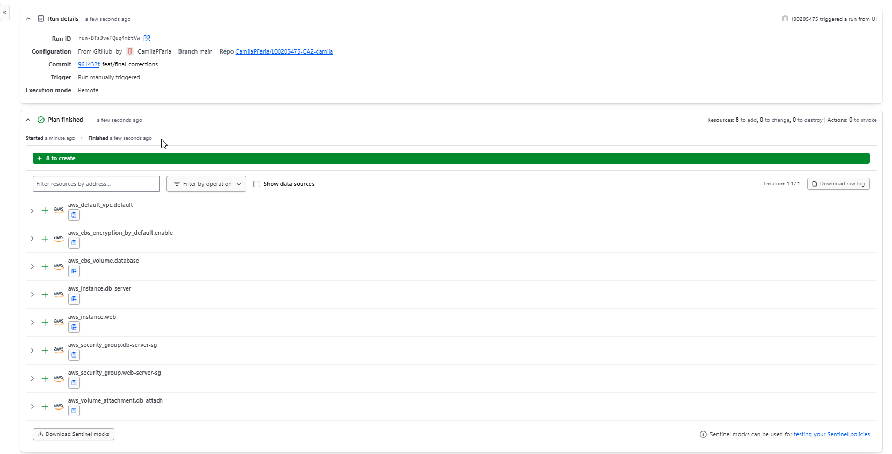
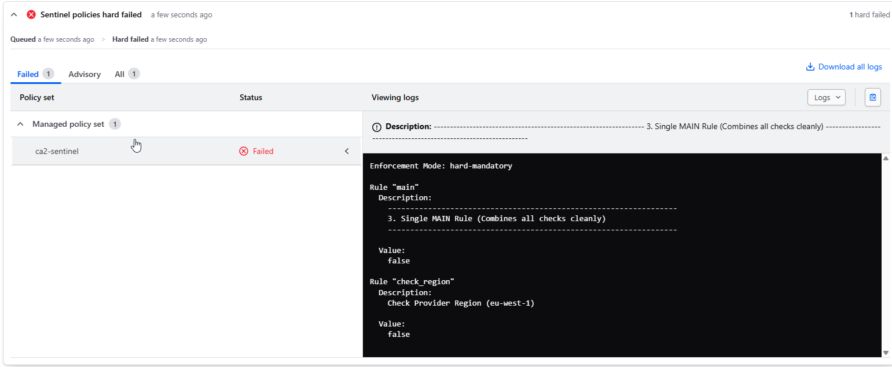
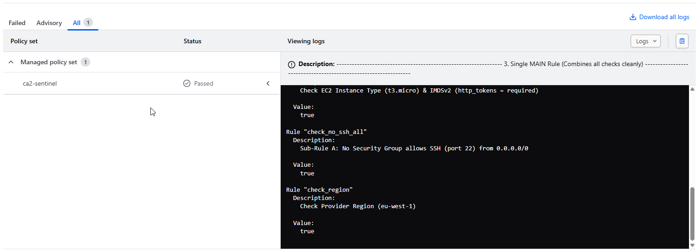

# Project Development & Policy Validation Report

## 1. Local Testing and Validation
During the development of the project, local tests were conducted to validate the Sentinel policies against the Terraform plan:

```hcl




```

## 2. HCP Terraform Verification
Additionally, policy evaluations were verified using HCP Terraform. 

### Terraform Plan Details
The Terraform plan is shown below:

```hcl
# 
```

## 3. Policy Check Evidence
Below is evidence of the policy checks, demonstrating both initial failures and subsequent successful evaluations:






```text
# [Enforcement Mode: hard-mandatory

Rule "main"
Description:
-----------------------------------------------------------------
3. Single MAIN Rule (Combines all checks cleanly)
-----------------------------------------------------------------

Value:
true

Rule "check_db_sg_restricted"
Description:
Sub-Rule B: Database Security Group has NO direct CIDR block rules

Value:
true

Rule "check_ebs_encryption"
Description:
Check Standalone EBS Volume Encryption

Value:
true

Rule "check_ec2_root_encryption"
Description:
Check Root Block Device Encryption for EC2

Value:
true

Rule "check_instance_type_and_imdsv2"
Description:
Check EC2 Instance Type (t3.micro) & IMDSv2 (http_tokens = required)

Value:
true

Rule "check_no_ssh_all"
Description:
Sub-Rule A: No Security Group allows SSH (port 22) from 0.0.0.0/0

Value:
true

Rule "check_region"
Description:
Check Provider Region (eu-west-1)

Value:
true
```